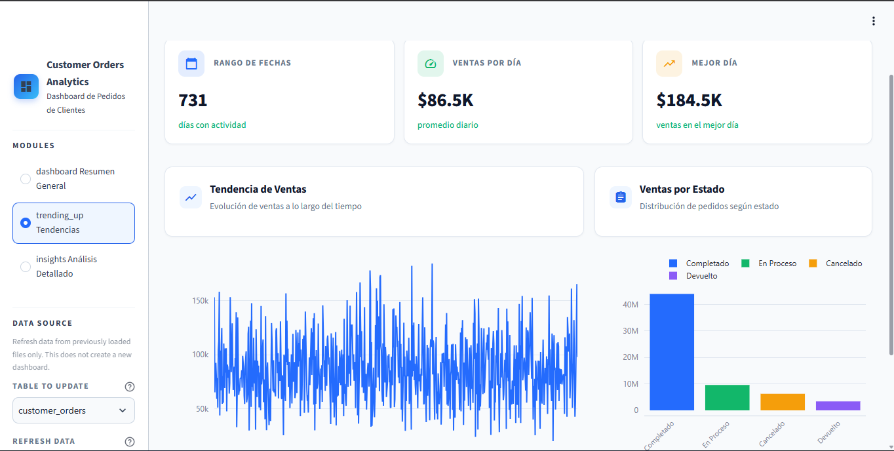

# AgentUI Dash



**Genera un dashboard corporativo desde un CSV en minutos con un agente de IA.**

AgentUI Dash conecta un agente de IA (vía MCP) con DuckDB y Streamlit para crear dashboards funcionales: el agente carga los datos, detecta columnas, genera KPIs y gráficos, y entrega un dashboard listo para usar. Los números se validan con verificación cruzada automática.

## Para quién es

Para **freelancers y agencias** que crean dashboards para clientes.

| Sin AgentUI Dash | Con AgentUI Dash |
|---|---|
| Horas de código SQL y Python | Minutos con un prompt |
| Riesgo de errores de cálculo | Validación cruzada automática |
| Dashboard único por proyecto | Reutilizable con cualquier CSV |

## Quickstart

**Paso 1 — Instalar uv**

**Windows:**
```powershell
powershell -ExecutionPolicy Bypass -c "irm https://astral.sh/uv/install.ps1 | iex"
```

**macOS / Linux:**
```bash
curl -LsSf https://astral.sh/uv/install.sh | sh
```

**Paso 2 — Clonar el repositorio e instalar**

```powershell
git clone https://github.com/Wiliam-L/agentui-dash.git
cd agentui-dash
uv sync
```

`uv sync` instala Python automáticamente si no lo tienes, y descarga todas las dependencias necesarias.

**Paso 3 — Conectar con tu cliente MCP**

**Opencode** — agrega esta entrada en `~/.config/opencode/opencode.jsonc`:

```json
{
  "mcpServers": {
    "agentui-dash": {
      "command": "uv",
      "args": ["run", "agentui-mcp"]
    }
  }
}
```

**Junie** — agrega esta entrada en `~/.junie/mcp/mcp.json`:

```json
{
  "mcpServers": {
    "agentui-dash": {
      "command": "uv",
      "args": ["run", "agentui-mcp"]
    }
  }
}
```

> ⚠️ Asegúrate de ejecutar estos comandos desde el directorio del repositorio clonado, o configura el `cwd` en la entrada del servidor MCP.

**Paso 4 — Probar con datos de ejemplo**

Un CSV de ejemplo ya viene incluido en [`examples/ventas.csv`](examples/ventas.csv). Dile al agente:

> «Tengo `examples/ventas.csv`, créame un dashboard.»

El agente llamará `create_dashboard()` y devolverá la URL del resultado.

## Cómo funciona

```
Usuario  →  Agente IA  →  MCP Server  →  ui_config.json  →  Streamlit UI  →  DuckDB
```

1. El usuario indica un archivo CSV o Excel al agente.
2. El agente ingesta los datos en DuckDB, detecta el rol de cada columna, y genera KPIs y gráficos.
3. El MCP escribe `ui_config.json` — el contrato completo del dashboard.
4. Streamlit lee el JSON y renderiza la UI. Si el JSON cambia, se actualiza en caliente sin reiniciar.

[Arquitectura detallada →](docs/ARCHITECTURE.md)

## Por qué puedes confiar en los números

- **`cross_validate_config()`** — verifica que los totales de los KPIs coincidan con la suma de las barras de los gráficos. Si no coinciden, alerta al agente para que corrija.
- **`safe_sql()`** — usa `sqlglot` para parsear el AST de cada consulta y bloquea operaciones de escritura, acceso a archivos o red antes de ejecutar.
- **`validate_config()`** — ejecuta cada consulta SQL del config y verifica que retorna resultados válidos.
- **Validación de columnas** — al actualizar datos, se comprueba que las columnas del nuevo archivo coincidan con las esperadas.

## Personalización y entrega al cliente

- **White-label** — cambia `brand_name`, `brand_sub`, `brand_icon` y `footer` en el config para personalizar la marca.
- **Exportación a PDF** — la funcionalidad existe en el código base (`core.pdf_export`) pero **no es estable** actualmente. No se muestra ningún botón en la UI; es necesario adaptarlo y pulirlo según las necesidades antes de exponerlo.
- **Actualización de datos** — el dashboard incluye un file uploader para que el cliente actualice los datos sin depender del agente.
- **Docker** — entrega el dashboard como contenedor aislado: `docker compose up --build`.
- **Recarga en caliente** — el agente puede modificar KPIs o gráficos en tiempo real sin reiniciar Streamlit.
- **JSON como contrato** — `ui_config.json` define la estructura del dashboard (módulos, KPIs, gráficos, filtros). Cualquier frontend que conozca este esquema puede consumirlo, no solo Streamlit.

## Herramientas MCP

El agente tiene acceso a **32 herramientas públicas** organizadas en categorías: dashboard, datos, configuración, consultas, filtros, detección, gráficos, exportación y servidor.

[Lista completa de herramientas →](docs/TOOLS.md)

**Tipos de gráficos:** `bar`, `bar_h`, `bar_grouped`, `bar_stacked`, `line`, `pie`, `scatter`, `heatmap`

## Instalación avanzada

Para todas las opciones de instalación (código fuente, Docker, otros clientes MCP, troubleshooting):

[Guía de instalación →](docs/INSTALL.md)

## Limitaciones conocidas

- DuckDB no es un motor multiusuario: el diseño usa conexiones efímeras para convivir entre MCP y Streamlit.
- El SQL de KPIs y gráficos viene del agente; `safe_sql()` mitiga riesgos, pero la calidad depende de lo que el agente produzca.
- El dashboard está diseñado para **archivos de datos relacionados** (mismo dominio). Para archivos no relacionados, el agente debe generar dashboards separados.
- No hay soporte automático para JOINs entre tablas; el agente puede escribirlos manualmente con `update_config()`.
- **Exportación a PDF** — la funcionalidad de generar reportes PDF existe en el código base (`core.pdf_export`) pero **no es estable** en su estado actual. No se expone en la UI; requiere adaptación y pruebas adicionales antes de habilitarlo en producción.

## Roadmap

1. Workspaces múltiples (aislar dashboards por proyecto).
2. Fuentes de datos externas (PostgreSQL, MySQL).
3. Personalización avanzada de temas y layouts.
4. **Exportación a PDF estable** — mejorar la funcionalidad de generación de reportes PDF y exponerla en la UI cuando sea necesario.
5. **Autenticación y acceso seguro** — integrar un reverse proxy (Cloudflare Access o Auth0) para proteger dashboards con login sin modificar código de la app.

## Licencia

[MIT](LICENSE) — libre para evaluación y demo.